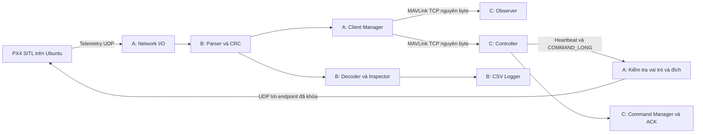

# Kiến trúc và phân công

## Luồng dữ liệu

## Trách nhiệm và vị trí

| Phần | Vị trí | Đầu ra |
|---|---|---|
| A | `src/gateway` | UDP/TCP, phân quyền, chuyển raw frame, hàng đợi và vòng đời client |
| B | `src/processing`, `src/logging`, API trong `include/mavlink_gateway` | Khung hợp lệ, dữ liệu giải mã, Inspector SEQ, CSV và summary |
| C | `src/client`, `tools`, kiểm thử trong `tests` | Console, lệnh/ACK/retry, dữ liệu giả lập và thống kê client |
| Dùng chung | `src/config`, `include/mavlink_gateway/config.hpp`, `config` | JSON đã kiểm tra và cấu hình hiệu lực |

`apps/gateway_main.cpp` và `apps/client_main.cpp` ghép các module thành chương trình. Header nội bộ gateway/client nằm cạnh phần triển khai; header dùng chung nằm trong `include`. Chỉ có một bản contracts.hpp của nhóm.

## Build và phụ thuộc

CMake tạo thư viện nội bộ `mgw_processing`, `mgw_logging`, `mgw_config`, `mgw_gateway`, `mgw_transport`, `mgw_client`; các executable link thư viện cần dùng. Fixture generator dùng MAVLink C trực tiếp, không gọi parser B để giữ phép đối chiếu độc lập.

Thư viện ngoài nằm trong `third_party`, được lưu cùng repository để build offline sau khi có toolchain. Không tự nâng phiên bản MAVLink/JSON khi configure.

## Ranh giới nền tảng

Gateway hiện dùng Winsock và Windows process metrics. Preset hỗ trợ Windows MinGW UCRT64; CMake báo rõ khi chọn nền tảng khác. Chưa triển khai gateway Linux. PX4 có thể chạy trên máy Ubuntu riêng qua UDP; laptop dual boot không chạy đồng thời hai hệ điều hành.

## Đầu vào và dữ liệu sinh ra

Mã nguồn, fixture, cấu hình mẫu, sơ đồ và tài liệu là đầu vào trong Git. `build` chứa cache, thư viện và executable; `output` chứa log và bằng chứng chạy. Cấu hình riêng của máy dùng `config/*.local.json`. Các dữ liệu sinh ra và cấu hình riêng được Git bỏ qua.
